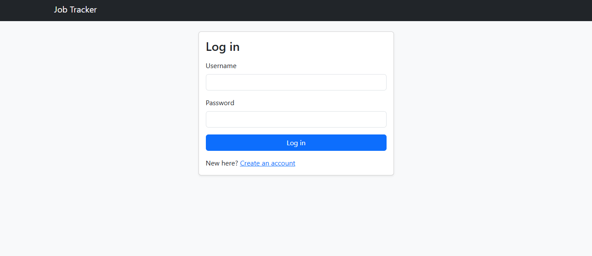
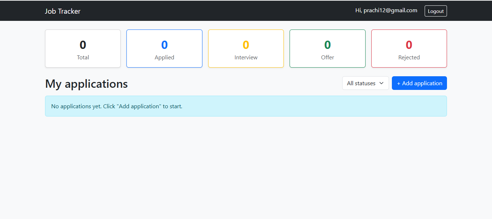
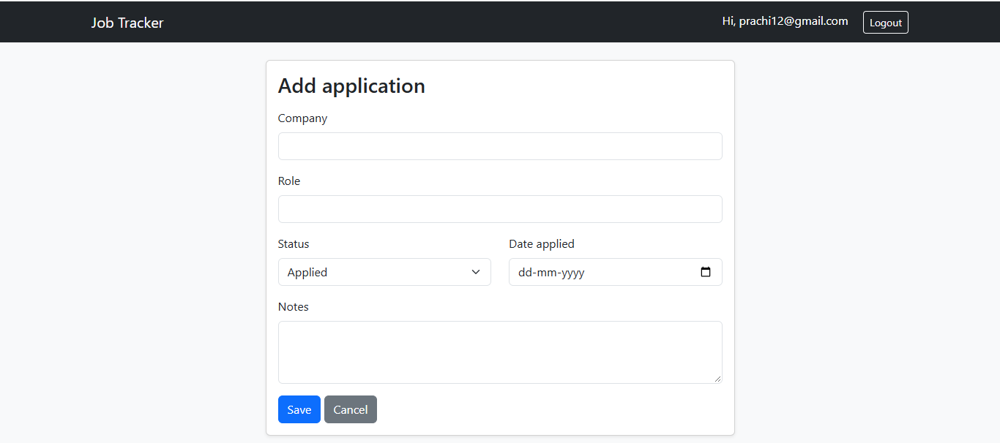

# Job Application Tracker

A full-stack web app to track job applications, built to manage my own job search.

**Live demo:** https://job-tracker-hktw.onrender.com
*(Hosted on a free tier: the first load may take 30-60 seconds while the app wakes up. Data may reset when the app restarts.)*

## Features
- User signup and login with hashed passwords (Werkzeug)
- Session-based authentication with protected routes
- Add, edit, and delete job applications (full CRUD)
- Each user can only see and modify their own data
- Filter applications by status (Applied, Interview, Offer, Rejected)
- Dashboard cards showing counts per status, computed with SQL `GROUP BY`
- Form validation and flash messages

## Tech Stack
- **Backend:** Python, Flask
- **Database:** SQLite (relational schema with foreign keys and constraints)
- **Frontend:** HTML, Jinja2 templates, Bootstrap, CSS
- **Deployment:** Render, Gunicorn
- **Version control:** Git, GitHub

## Screenshots

## Database Design
- `users` (id, username, password_hash)
- `applications` (id, user_id, company, role, status, applied_date, notes)
- `applications.user_id` is a foreign key to `users.id`
- A `CHECK` constraint limits status to valid values

## Run Locallygit